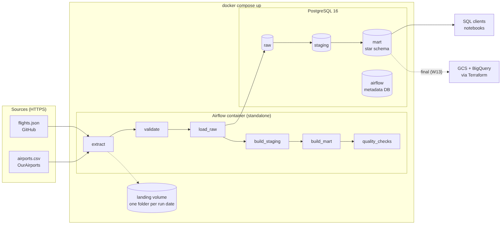

# Flight Records Pipeline — DENG HS26

End-to-end batch data pipeline over the released Epstein flight logs (1995–2015).
Team: **Aleksandrs Unterkirhers** & **Johan Yong-Bin Roth** · Data Engineering, HSLU, HS26

> **Status: Midterm (Architecture v0.2)** Fully local pipeline: Airflow + PostgreSQL in Docker Compose.
> Cloud (Terraform → GCS + BigQuery) follows for the final.

---

## 1. Use case

| | |
|---|---|
| **Users** | Newsroom research desks, investigative journalists, transparency researchers |
| **Question** | *What travel patterns are documented in the flight records — routes, frequency, aircraft, time periods — and how do they change over time?* |
| **Data product** | A queryable star schema (`mart` schema) + a pre-aggregated route × month table |
| **Today** | The records exist as PDFs and one-off spreadsheets: not queryable, not joined, not reproducible |

Descriptive analytics only. **Appearing in a flight log is not evidence of wrongdoing.** We make no
inferences about individuals, unnamed passengers stay anonymous.

## 2. Data sources

| | `flights.json` (main source) | `airports.csv` (enrichment) |
|---|---|---|
| Provenance | Handwritten pilot logs + FOIA records → court filings → 3rd-party transcription → GitHub [valinux/flight-logs-explorer](https://github.com/valinux/flight-logs-explorer) | [OurAirports](https://ourairports.com/data/) (public domain) |
| Access | HTTPS GET [raw file](https://raw.githubusercontent.com/valinux/flight-logs-explorer/main/flights.json) | HTTPS GET [airports.csv](https://davidmegginson.github.io/ourairports-data/airports.csv) |
| Format | JSON `{"headers": [...], "rows": [[...]]}`, 22 columns | CSV, 19 columns |
| Volume | 5,001 rows, ~1.3 MB | ~86,000 rows, ~13 MB |
| Grain | one passenger on one flight leg | one airport |
| Updates | none — historic, closed dataset | continuously (codes get renamed) |

**Data-quality risks found while profiling** (and how we handle them):

| Issue | Example | Handling |
|---|---|---|
| Airport re-coded in reference data | `PBI` is now `DJT` → 2,561 of 10,002 code references fail a naive join | manual alias table (`staging.airport_code_alias`) |
| Mixed code formats | IATA `TEB`, ICAO `TIST`, FAA `X21`, `TIST-LSJ`, `PBI-OFF`, lowercase `TEb` | trim + upper-case, lookup over all code types, aliases |
| "Unique ID" not unique | 4,993 distinct values for 5,001 rows | use the row `ID` as key; build our own `leg_key` |
| Incomplete names | `? ?`, initials, `Female (1)` | `? ?` / empty → NULL; names kept exactly as recorded |
| Same tail number, different aircraft | `N908JE` = Gulfstream *and* Boeing 727 | aircraft key = tail + model |
| Transcribed from handwriting | typos in codes (`TPQF` instead of `TQPF`) | alias table, documented in SQL |

## 3. Architecture v0.2



*Diagram source: [`docs/architecture_v0.2.mmd`](docs/architecture_v0.2.mmd) (Mermaid).*

### What changed since v0.1 (and why)

| v0.1 (pitch) | v0.2 (implemented) | Why |
|---|---|---|
| "2 services" | 3 services: `postgres`, `airflow-init` (one-shot), `airflow` | The landing volume must be writable by the Airflow user and Airflow's metadata DB must be migrated before the scheduler starts. A one-shot init container is the standard Airflow pattern for this. |
| Airflow stores metadata "in the same Postgres" | Same Postgres **instance**, separate **database** `airflow` | Keeps Airflow's ~50 internal tables out of our warehouse, one container less than a second Postgres. |
| Downloads not specified | Landing zone `landing/<source>/<run_date>/` (Docker volume) | Every run keeps the exact file it loaded → traceable, and backfills for a past date don't overwrite other runs. |
| Hash check "skip when unchanged" | Implemented via `raw.load_log` (SHA-256 per load) | Visible proof of idempotency, the log also documents every load. |
| Airport join on IATA code | Lookup over IATA / ICAO / ident / GPS / FAA local codes + manual alias table | Profiling showed the logs mix code systems, IATA alone matched far too few rows. |
| `dim_person` | `dim_passenger` with key 0 = unknown | Name renamed for clarity, missing names need their own member so the fact table has no NULL keys. |
| `dim_aircraft` keyed by tail number | keyed by tail number + model | The same tail number was used for different aircraft. |

## 4. Repository structure

```
├── docs/                     # architecture diagram (PNG + Mermaid source)
├── docker-compose.yml        # postgres, airflow-init, airflow on network "deng"
├── .env.example              # all settings/credentials (copy to .env)
├── initdb/01_init.sh         # first Postgres start: airflow DB + raw/staging/mart schemas
├── dags/flights_pipeline.py  # the Airflow DAG (schedule, dependencies, retries)
├── pipeline/                 # modular ingestion & processing code (plain Python)
│   ├── config.py             #   source URLs + expectations (columns, row ranges)
│   ├── extract.py            #   download -> landing zone, SHA-256
│   ├── validate.py           #   schema + row-count check before loading
│   ├── load_raw.py           #   full load into raw.*, one transaction, load_log
│   ├── transform.py          #   runs sql/<layer>/*.sql in one transaction
│   ├── quality.py            #   data-quality checks on the result
│   └── db.py                 #   Postgres connection from env variables
└── sql/
    ├── staging/              # cleaning, typing, airport resolution
    └── mart/                 # star schema + aggregate
```

## 5. Setup & run

**Prerequisites:** Docker with Compose v2 (Docker Desktop, OrbStack, or Docker Engine), ~3 GB free disk,
ports `8080` and `5432` free (otherwise change them in `.env`). Internet access to GitHub and ourairports.

```bash
git clone https://github.com/LittleBigFatFish/deng_project.git
cd deng_project
cp .env.example .env          # local defaults work as-is
docker compose up -d          # first start pulls images (~1-2 min)
docker compose ps             # wait until airflow shows "(healthy)", ~1 min
```

- **Airflow UI:** http://localhost:8080 — login `admin` / `admin` (from `.env`)
- The DAG `flights_pipeline` is **unpaused automatically** and runs once for the latest weekly interval right after startup (~1 min).
- To start a run manually: UI → `flights_pipeline` → ▶ *Trigger DAG*, or
  ```bash
  docker compose exec airflow airflow dags trigger flights_pipeline
  ```

**Stop / reset**
```bash
docker compose down        # stop, keep data
docker compose down -v     # stop and delete all data (fresh start)
```

## 6. Verification

**1 — All tasks green.** UI → `flights_pipeline` → *Grid*: 9 tasks, all *success*. Or:
```bash
docker compose exec airflow airflow dags list-runs -d flights_pipeline
```

**2 — Data is loaded and queryable.**
```bash
docker compose exec postgres psql -U deng -d deng
```
```sql
-- row counts per layer
SELECT 'raw.flights' AS tbl, COUNT(*) FROM raw.flights
UNION ALL SELECT 'raw.airports', COUNT(*) FROM raw.airports
UNION ALL SELECT 'staging.flight_passengers', COUNT(*) FROM staging.flight_passengers
UNION ALL SELECT 'mart.fact_passenger_leg', COUNT(*) FROM mart.fact_passenger_leg
UNION ALL SELECT 'flight legs', COUNT(DISTINCT leg_key) FROM mart.fact_passenger_leg;
```
Expected: `raw.flights` 5001 · `raw.airports` ~86,000 · `staging.flight_passengers` 5001 · `fact_passenger_leg` 5001 · flight legs 1491.

```sql
-- use-case query: most frequent routes
SELECT d.airport_name AS departure, a.airport_name AS arrival, SUM(r.flight_legs) AS legs
FROM mart.agg_route_month r
JOIN mart.dim_airport d ON d.airport_key = r.dep_airport_key
JOIN mart.dim_airport a ON a.airport_key = r.arr_airport_key
GROUP BY 1, 2 ORDER BY legs DESC LIMIT 5;
```
Expected top route: Palm Beach (shown under its current name *President Donald J. Trump International Airport*) → Teterboro, 141 legs.

```sql
-- flights per year
SELECT dd.year, COUNT(DISTINCT f.leg_key) AS legs
FROM mart.fact_passenger_leg f JOIN mart.dim_date dd ON dd.date_key = f.date_key
GROUP BY dd.year ORDER BY dd.year;

-- load history (shows full loads and skipped unchanged files)
SELECT source, run_id, status, row_count, loaded_at FROM raw.load_log ORDER BY loaded_at;
```

**3 — Data-quality checks.** UI → task `quality_checks` → *Logs*: 9 lines `PASS ...`.

**4 — Rerun & backfill.**
```bash
# rerun: trigger again -> loads are skipped (same SHA-256), tables rebuilt, same counts
docker compose exec airflow airflow dags trigger flights_pipeline

# backfill a past weekly interval (@weekly = Sundays 00:00 UTC)
docker compose exec airflow airflow dags backfill -s 2026-09-06 -e 2026-09-06 flights_pipeline
docker compose exec airflow ls /opt/airflow/landing/flights   # one folder per run date
```
In the UI, any single task can be rerun with *Clear*; downstream tasks rerun automatically.

## 7. Design decisions

### Ingestion: full load, weekly, fail loud
- **Full instead of incremental load.** `flights.json` is a closed historic dataset: there are no new rows to pick up incrementally. `airports.csv` has no reliable "last changed" field. Both files are small (seconds to load), so a full reload is the simplest correct option.
- **Weekly schedule.** The flight logs never change, the airport reference changes rarely (code renames). Weekly keeps the reference fresh at negligible cost. A daily schedule would only produce "skipped_unchanged" entries.
- **Idempotent.** Each raw load runs `DROP/CREATE + COPY + log entry` in **one transaction**: either the new data is fully there, or the old data is untouched. If the file's SHA-256 equals the last successful load, the reload is skipped. Staging and mart tables are rebuilt from scratch in one transaction per layer. Running the DAG twice gives the same result.
- **Failure behaviour.**
  - Network/HTTP errors → task fails → **3 retries with exponential back-off**.
  - Downloads are written to a `.part` file and renamed only when complete.
  - **Validation before loading:** required columns present, row count within expected range (flights 4,500–6,000; airports 70,000–150,000). A truncated or changed file fails here and never replaces good data.
  - `quality_checks` has **no retries**: a failed check is a data problem, not a transient error.
  - `max_active_runs=1`, because all runs rebuild the same tables.
- **Backfills.** `catchup=False`, so starting the stack does not create dozens of past runs. Past intervals can be run explicitly with `airflow dags backfill`, each run stores its download under its own run date. *Limitation:* the sources only offer their current version, so a backfill re-loads today's file: it does not recreate historic snapshots.

### Storage layers (PostgreSQL schemas)
| Layer | Content | Why |
|---|---|---|
| `landing` (volume) | downloaded files per run date | exact input of each run, re-loadable without network |
| `raw` | source 1:1, all columns `TEXT`, + `_run_id`, `_loaded_at`, `load_log` | a bad value can never break the load, typing happens later |
| `staging` | typed, cleaned, airports resolved | one place for all cleaning rules |
| `mart` | star schema + aggregate | what users query |

### Transformations (and how they support the use case)
| Transformation | Where | Supports |
|---|---|---|
| Normalise codes (trim, upper), resolve to reference airport via IATA/ICAO/FAA/alias | `staging/03`, `staging/04` | routes need readable names, countries and coordinates, without the PBI alias 26 % of code references would be lost |
| Type columns (date, int, boolean), placeholder names → NULL | `staging/04` | correct time-based analysis and counts |
| `leg_key` = hash(date, aircraft, route, flight no.) | `staging/04` | "number of flights" (1,491) instead of passenger rows (5,001) |
| Great-circle distance per leg | `mart/05` | distance flown per route/aircraft/period |
| Star schema | `mart/01–05` | flexible slicing by time, route, aircraft, passenger |
| `agg_route_month` | `mart/06` | answers the main question directly: route frequency over time |

### Data model (grain of every mart table)
| Table | One row = | Key |
|---|---|---|
| `fact_passenger_leg` | one passenger entry on one flight leg (= one source record) | `record_id` |
| `dim_date` | one calendar day | `date_key` |
| `dim_airport` | one airport used in the logs | `airport_key` (OurAirports ident) |
| `dim_aircraft` | one tail number + model combination | `aircraft_key` |
| `dim_passenger` | one passenger name as recorded (`0` = unknown) | `passenger_key` |
| `agg_route_month` | one month × departure × arrival airport | — |

Count flights with `COUNT(DISTINCT leg_key)`, passenger entries with `COUNT(*)`.

### Data-quality checks (`pipeline/quality.py`)
Row count plausible · every raw record reaches the fact table · no duplicate keys · no missing dates ·
dates within 1990–2020 · ≥ 99 % of airport codes resolved · referential integrity fact → dim_airport ·
every row has an aircraft · aggregate sums match the fact table.

## 8. Known limitations
- **3 airport codes stay unresolved** (`W47`, `ZORRO`, `SBGK` — private strips or invalid codes; 17 of 10,002 references). They keep `NULL` airport keys and no distance.
- **Passenger identity is a name string.** Spelling variants of the same person count as different passengers; unnamed people (`Female (1)`) are not linked across flights — on purpose.
- **Leg key heuristic:** two legs on the same day with same aircraft, route and *missing* flight number collapse into one leg.
- **Alias table is manual** and must be extended if new unmatched codes appear (the quality check would fail first).
- **Backfills reload the current source version**, not historic snapshots (sources are not versioned).
- **`airflow standalone`** runs scheduler, web server and triggerer in one container — fine for local development, not for production.
- **Secondary source:** transcribed from handwriting; no licence is stated on the GitHub repository.
- **Local only** for the midterm. Terraform, GCS and BigQuery follow for the final.

## 9. Project plan
| Week | Milestone | Status |
|---|---|---|
| W3 | Pitch: README, use case, Architecture v0.1 | ✅ |
| W6/7 | Local pipeline: ingestion → Postgres, Airflow, Docker Compose, transformations — Architecture v0.2 | ✅ |
| W13/14 | Terraform (GCS bucket + BigQuery dataset), cloud ingestion, BigQuery models with partitioning/clustering, final architecture | ⏳ |
